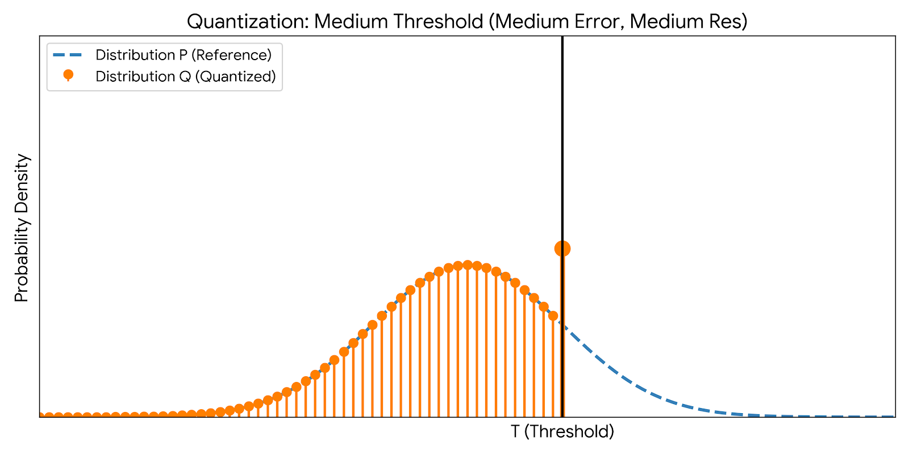
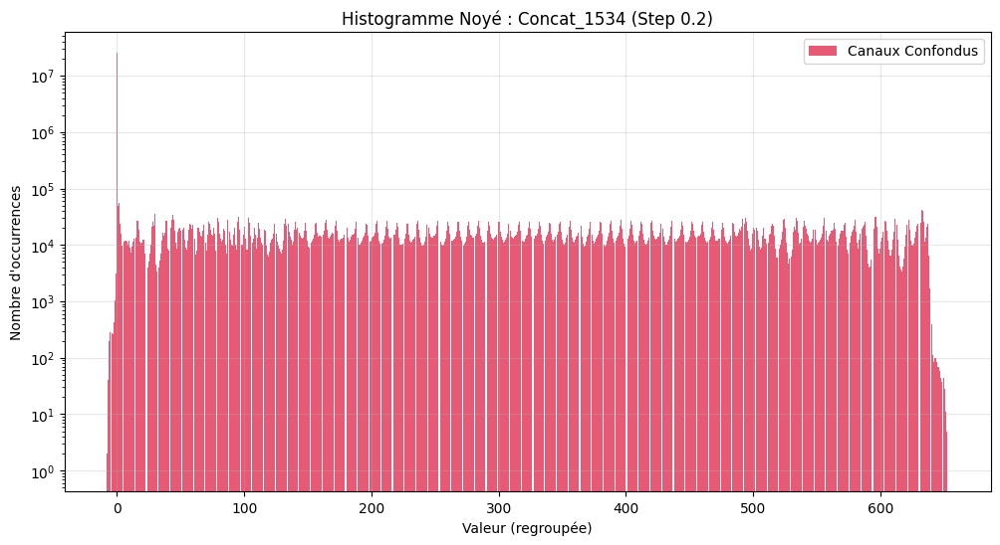
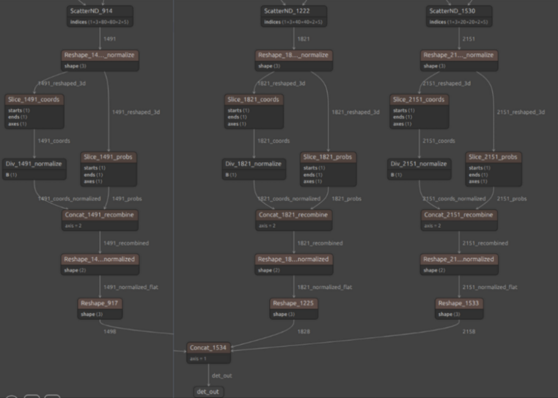

# YOLOP: Optimized & Quantized for Embedded NPU
### Industrial Project - ENSICAEN x Valeo

> **Fork Note:** This repository is a fork of the official [YOLOP](https://github.com/hustvl/YOLOP) repository. It includes specific optimizations for **INT8 Quantization** and deployment on NPU/Embedded devices (e.g., Smartphones, Automotive ECUs), developed during an industrial project at [ENSICAEN](https://www.ensicaen.fr/) in collaboration with [Valeo](https://www.valeo.com/).

---

##  Project Goal: From Research to Real-Time Embedded

The original YOLOP model achieves State-of-the-Art performance in panoptic driving perception (Traffic Object Detection + Drivable Area Segmentation + Lane Detection). However, deploying such models on edge devices requires heavy optimization, specifically **INT8 Post-Training Quantization (PTQ)**.

**Our Objectives:**
1.  **Drastic Size Reduction:** Compress the model weights for limited storage.
2.  **Hardware Acceleration:** Enable execution on NPUs (Neural Processing Units) which often require INT8 format.
3.  **Preserve Accuracy:** Maintain mAP and mIoU metrics as close as possible to the FP32 baseline.

---

##  Quantization Strategy & Challenges

### 1. Calibration Method: Entropy & KL Divergence
We selected the **Entropy** calibration method over MinMax. It minimizes the information loss between the original Float32 distribution ($P$) and the quantized INT8 distribution ($Q$) using **Kullback-Leibler Divergence**.

$$D_{KL}(P||Q) = \sum_{i} P(i) \log \frac{P(i)}{Q(i)}$$

*Figure 1: Illustration of finding the optimal threshold $T$ using KL Divergence to balance resolution and clipping error.*

### 2. The "Concat Node" Issue
During our analysis, we identified a critical bottleneck at the `Concat_1534` node (the final concatenation of detection heads).
* **Problem:** This node merges Probability scores ($\in [0, 1]$) with Bounding Box coordinates ($\in [0, 640]$).
* **Consequence:** The quantization scale is dictated by the large coordinates. As a result, the small probability values are "drowned" in the first quantization bin and rounded to 0.
* **Symptom:** The quantized model had valid segmentation but **0% mAP** in detection (no boxes detected).

*Figure 2: Histograms showing probability values crushed by the scale of coordinates.*

---

##  Implemented Solution: Architectural Normalization

To solve the scale conflict without retraining (QAT), we modified the ONNX graph structure directly.

**Solution:** **Pre-Concatenation Normalization**
We inserted **Division nodes ($/640$)** on the coordinate branches *before* the concatenation.
* **Effect:** All inputs to the `Concat` node are now in the $[0, 1]$ range.
* **Result:** The quantization scale is adapted to the probabilities, preserving the detection signal.
* **Post-Processing:** A corresponding de-normalization step ($\times 640$) was added to the CPU post-processing code.

*Figure 3: Injection of normalization nodes in the ONNX graph.*

### 3. "Resistant" BatchNorm Handling (Mixed Precision)
Some `BatchNormalization` layers could not be merged into convolutions and caused "Axis out of range" errors with standard Per-Channel quantization.
* **Fix:** Implementation of a **Two-Pass Quantization Strategy**.
    1.  **Pass 1:** Quantize 99% of the network (Convolutions) using Per-Channel.
    2.  **Pass 2:** Identify "resistant" layers and quantize them using **Per-Tensor** strategy.
* **Outcome:** A fully quantized 100% INT8 model with no crashes.

---

##  Final Results & KPIs

We achieved a fully functional INT8 model suitable for NPU deployment.

| Metric | Baseline (FP32) | **Optimized INT8** | Delta |
| :--- | :--- | :--- | :--- |
| **Model Size** | 34.24 MB | **11.83 MB** | **-65% (2.89x smaller)** |
| **Drivable Area mIoU** | 91.24% | **90.99%** | -0.25% (Negligible) |
| **Lane Detection mIoU** | 26.2% | **20.35%** | -5.8% |
| **Detection Recall** | 89.11% | **85.22%** | -3.9% |
| **Detection mAP@50** | 71.94% | **58.20%** | -13.7% |

> **Note on Detection Drop:** While the detection functionality was successfully restored (from 0% to ~58% mAP), a gap remains compared to FP32. Further investigation suggests this is an intrinsic limit of PTQ on this specific detection head architecture. Retraining with **Quantization Aware Training (QAT)** would be the next step to recover this accuracy.

*Figure 4: Visual comparison. The INT8 model (bottom) successfully detects vehicles and segments the road, validating the normalization approach.*

---

## Authors

**Industrial Project Team - ENSICAEN:**
* Arthur DEFORGE
* Jeremy FADLOU

**Supervisors:**
* Said EL-HACHIMI (Valeo)
* Miloud FRIKEL (ENSICAEN)

---

*(Below is the original README from the YOLOP authors)*
